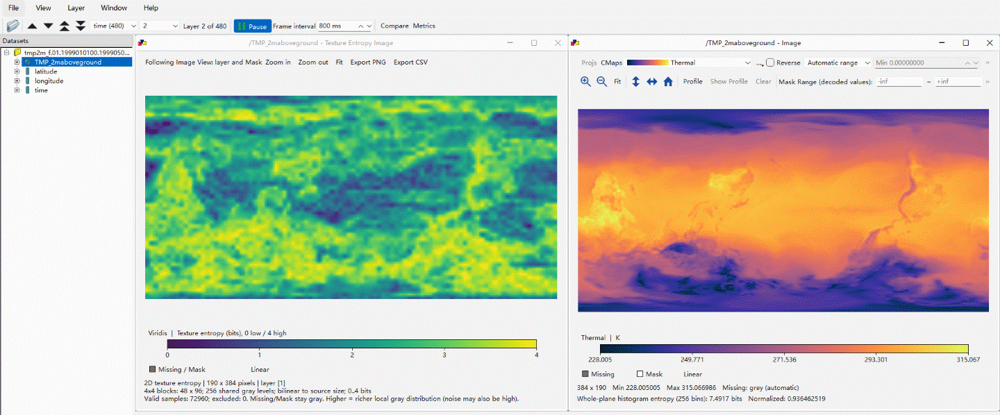

# HDFStudio — NetCDF & HDF5 Viewer for Windows

**Unleash Your NetCDF Power.**

**English** | [简体中文](README_CN.md)

🔢 **Version 0.12.08** — independent 2D texture entropy images, scientific color maps, cached recoloring, image zoom, lead/lag comparison, pair metrics, residual maps and joint slice playback.

⬇️ **Download:** get `HDFStudio-<version>-win64.zip` from the [latest release](https://github.com/DuLiangMin/HDFStudio/releases/latest). **Portable (green) app:** unzip it anywhere and double-click `HDFStudio.exe` to run. No installation and no administrator rights needed.

[](https://github.com/DuLiangMin/HDFStudio/releases/latest)
[](https://github.com/DuLiangMin/HDFStudio/releases)
[](LICENSE)
[](#-download-and-run)
[](https://www.qt.io/)

HDFStudio is a free, open-source desktop **NetCDF viewer** and **HDF5 browser** for Windows, built for
meteorology, climate and earth-science work. Open a `.nc`, `.nc4`, `.h5` or `.hdf5` file, browse
groups, variables and attributes, read values in a table, view 2-D slices as images, decode time
coordinates into real dates, and check CF metadata conventions, all without writing code.



*Recorded from the running Windows application: 2-metre temperature (`TMP_2maboveground`, 384 × 190, 480 layers) in cmocean Thermal, alongside its synchronized 4×4 local texture entropy image in Viridis. The green Play button advances both views. Entropy has its own fixed 0–4 bits scale. [View the static screenshot](docs/screenshot-main.png).*

### 🆕 New in 0.12.08

| Capability | How to use it |
|---|---|
| 🖼️ Independent **2D texture entropy** | **View → Texture Entropy Image**, or right-click a variable. View local 4×4 complexity, browse layers, apply Mask, export original-size PNG and numeric CSV. |
| 🔗 **Lead/lag and multi-view synchronization** | Choose Anchor/Targets in **Compare & Metrics**; set each integer lag and synchronize layers, zoom/pan/flips and optionally colors/ranges. |
| 📐 **Live comparison metrics** | Read Pearson r, RMSE, MAE and Bias together; copy the report or export a CSV with file, variable, layer and unit identities. |
| ➖ **Spatial residual map** | **Residual map** shows `Target − Anchor` with a zero-centered diverging scale and follows the selected layers and Mask. |
| ▶️ **Green Play / Pause** | Animate one dataset or linked views with an adjustable interval; metrics, residuals and source-following entropy update with the layers. |

**Validation:** clean Debug/Release builds each pass **83 QtTest checks**, with no failures or skips, plus CTest. Local entropy outputs are reconciled independently against NumPy, including exported PNG colors and missing/Mask pixels.

## 🤔 Why HDFStudio?

You have a `.nc` file from a model, a satellite product or a colleague, and you need to know **what is
really inside** before you trust it. Typical questions:

- Is `time` in seconds or days, and since when? Which calendar?
- Does latitude run south→north or north→south? Is longitude 0–360 or −180–180?
- Is this file CF compliant, or will my plotting library flip the map?

HDFStudio answers these in seconds, with no Python session, no notebook and no installation of a
scientific stack. It is a small, portable program (about 15 MB) that opens a file and shows you the facts.

### 🔬 From inspecting a slice to comparing model output

HDFStudio brings the following analysis tasks into the same workspace:

- **2D texture entropy images:** choose **View → Texture Entropy Image**, or the same variable context-menu item. Each non-overlapping 4×4 block produces a Shannon entropy value; numeric bilinear interpolation reconstructs the source image dimensions before coloring. The independent image has a fixed 0–4 bits colorbar, zoom/pan, layer navigation, and full-size PNG/numeric CSV exports. Opening it from an Image View follows that image's layer and Mask; no comparison is required.
- **Sliding comparison along a shared index axis:** choose an Anchor and one or more Target image views, select a leading axis such as `time`, then drag the Anchor layer slider. Each Target follows `target_index = anchor_index + lag`, with its own positive, zero or negative integer offset. Zoom, pan and flips can follow the Anchor; color/range synchronization is optional. Out-of-range targets clear and recover automatically.
- **Correlation and error together:** the live **Compare & Metrics** dock shows Pearson r, RMSE, MAE, Bias (`Target − Anchor`) and valid/excluded pair counts. Copy the report or export an atomic CSV record containing source paths, variables, layer indices, revisions and units. Single-image entropy is no longer included as a comparison result. The CLI uses the same core algorithms for independent numerical checks.
- **Residual maps:** open **Residual map** to locate positive and negative `Target − Anchor` differences spatially, with a zero-centered symmetric diverging color scale. The map follows the current layer and Mask, clears when comparison becomes invalid, supports zoom/pan and exports a full-resolution PNG.

**Try it:** open two image views (they may come from one file or different files), click the visible **Compare & Metrics** button in the main toolbar (or **Window → Compare & Metrics**), select Anchor/Target and the index axis, then set the lag and move the Anchor slider. Layer indices shown in this dock are **zero-based**.

For two forecasts initialized at different times, inspect their decoded time coordinates first and choose the index offset that corresponds to your intended comparison. Changing the selected Target retains the other Targets' individual offsets, so several forecast sequences can follow one Anchor.

**Scientific scope:** alignment is by integer layer index, including when the chosen axis is named `time`; HDFStudio does not infer hours/days or match coordinate timestamps. Pair calculations require identical plane shapes and use only pixels finite in both decoded, currently masked planes. There is no implicit interpolation, cropping, geographical registration or unit conversion. Units are retained, and differing units are marked unverified; a constant field has undefined Pearson r even when error metrics remain valid.

### 🖼️ Reading a texture entropy image

Decoded finite values share 256 gray levels spanning the current plane's min/max. Each 4×4 block uses `H=-Σp·log2(p)`: a constant block is 0 bits, and 16 equally frequent distinct gray levels give 4 bits. Partial edge blocks use actual samples without zero padding. All-missing blocks are invalid; source missing/Mask pixels remain gray. Interpolation ignores invalid neighbors and renormalizes weights without filling source gaps. Output row/column indices match the source, and PNG dimensions are identical; interpolation adds no physical detail.

Higher values indicate a richer local gray distribution. Noise may also be high, smooth gradients may be nonzero, and different pixel arrangements with identical histograms have equal entropy. This measures local complexity, not proof of a useful signal source. Quantization is recalculated from each plane and does not depend on display colors, reverse or zoom. The original scalar is explicitly labeled **Whole-plane histogram entropy** as a separate distribution diagnostic.

### ▶️ Slice playback — single dataset or linked comparison

The main toolbar has a green bitmap **Play / Pause** button and **Frame interval** control (default 500 ms, range 100–10,000 ms); the **Layer** menu contains the same action. Open an image, select a leading axis and press **Play** to animate its layers. Playback stops at the last layer; pressing Play there restarts from the first. **Play is disabled when the selected playback axis has fewer than two frames; linked comparisons use the Anchor's frame count.** The interval is a display delay, not the physical time step of the dataset.

For joint playback, open two images, select **Window → Compare & Metrics**, choose Anchor/Target and enable **Sync layer indices**. Set each Target's lag, then press **Play** from either linked image. **Next/Previous/First/Last, Go to Layer and the main layer selector also drive the Anchor** when a linked Target is active. Both images, metrics and an open residual map update together. Unlinked views retain independent navigation. Pause holds the current layer; changing the playback source/axis or comparison binding stops playback. This displays a slice sequence; it does not encode a video file.

| | HDFStudio | Panoply | ncview | HDFView |
|---|---|---|---|---|
| Windows native, portable zip | ✅ | Java required | ❌ | Java required |
| NetCDF **and** HDF5 | ✅ | ✅ | NetCDF | ✅ |
| Time decoded with the file's own calendar | ✅ (`noleap`, `standard`, …) | ✅ | ❌ | ❌ |
| Latitude / longitude orientation report | ✅ | ❌ | ❌ | ❌ |
| CF-1.8 compliance check built in | ✅ | ❌ | ❌ | ❌ |
| Packed and raw values side by side | ✅ decoded / stored / both grids | ❌ | ❌ | ❌ |
| Histogram of one layer | ✅ random sample, adjustable bins | ❌ | ❌ | ❌ |
| Custom curve profile | ✅ spline / polyline, bilinear, CSV export | ❌ | ❌ | ❌ |
| 2-D local texture entropy image | ✅ 4×4 blocks, 0–4 bits, PNG / numeric CSV | — not verified | — not verified | — not verified |
| Lead/lag comparison across multiple views | ✅ Anchor / Targets, individual integer offsets | — not verified | — not verified | — not verified |
| Live Pearson r / RMSE / MAE / Bias | ✅ finite-pixel intersection, report / CSV | — not verified | — not verified | — not verified |
| Spatial residual / difference map | ✅ Target − Anchor, zero-centered scale, PNG | ✅ [array differencing](https://www.giss.nasa.gov/tools/panoply/) | — not verified | — not verified |
| Slice animation | ✅ adjustable Play / Pause | ✅ [animation export](https://www.giss.nasa.gov/tools/panoply/) | ✅ [data movies](https://cirrus.ucsd.edu/ncview/) | ✅ [3-D true-color images](https://portal.hdfgroup.org/documentation/hdfview/latest/ug06imageview.html#section6_3) |
| Linked playback with live analysis | ✅ synchronized views, metrics, residuals and source-following entropy | — not verified | — not verified | — not verified |
| Map projections and coastlines | ❌ not yet | ✅ | ❌ | ❌ |

*Comparison reflects the author's understanding; check each tool's documentation for details. "Packed and raw" means showing `stored × scale_factor + add_offset` next to the integer in the file, in the same table; all four tools display decoded values, but only HDFStudio shows the two numbers together.*

## ✨ Features

- 📂 **Open NetCDF and HDF5 files**: NetCDF-3 (CDF-1, CDF-2, CDF-5; since 0.10.27, read through netCDF-C), NetCDF-4 / NetCDF-4 classic, and HDF5 containers; open several files at once. Drag files from Explorer and drop them anywhere in the window (tree, views, info panel, toolbar). Windows blocks drag and drop into a program running as administrator; HDFStudio then says so in the status bar. The format is detected from the file header, not the `.nc` extension.
- 🗂️ **Close files cleanly**: **File → Close File** (`Ctrl+F4` or `Ctrl+W`), **Close All Files**, or right-click any node → **Close File**. Views of a closed file close with it.
- 🌳 **Dataset tree**: groups, dimensions, variables and attributes with type and shape details.
- 🔢 **Data grid**: exact values in a table, with layer navigation for 3-D, 4-D and 5-D arrays. For NetCDF-3 files only the displayed 2-D plane is read, so a 700 MB variable opens in under 0.1 s.
- 🔀 **Two numbers, three grids** (0.10.30): a file can store one number and mean another (`decoded = stored × scale_factor + add_offset`), so the right-click menu offers three tables of the same variable:
  - **Data Grid (decoded to real)...** — the real values, the numbers the image view and the legend show.
  - **Stored Grid (raw value)...** — the numbers exactly as written in the file, before `scale_factor`/`add_offset`.
  - **Both Grids (decoded and raw)...** — one table with the decoded column next to its raw column, so a cell and the number it came from are read in the same row.

  Every header says which number it holds (`Value (decoded to real)`, `Value (raw)`, or `Value 1 (decoded)` / `Value 1 (raw)`), and the window title repeats it. Decoding starts from the stored number, not from its shortened text, so a `float32` value such as 123456789 is not rounded to 6 digits first. Checked against Python netCDF4 cell by cell on a 1201 × 1401 packed product: decoded, raw and both grids all match (1,682,601 cells each).
- ⬆️⬇️ **Layer toolbar**: next, previous, last and first layer buttons right after Open, with a dimension picker and a layer picker, and a `Layer n of N` readout. The **Layer** menu has the same commands (`Alt+←`/`Alt+→`/`Alt+Home`/`Alt+End`, `Ctrl+G` to type a layer number). Works on the grid and the image view of the active window, for any leading axis such as `time` or `lev`.
- 🔍 **Properties** like `print(netCDF4.Dataset(...))`: dimension names, unlimited dimension, and attribute values with arrays expanded.
- 📋 **Copyable Properties, built for extracting metadata** (0.10.29): right-click a file, group or variable → **Properties...**. The window shows a plain-text report you can select and copy (`Ctrl+C`), or copy in one go with **Copy All**. The report starts with the file path and object path, followed by shape, type, size, dimensions, storage layout and every attribute. Paste it into a search, an issue or an LLM prompt to ask about the file's NetCDF metadata and data without opening Python. The window is not modal, so you can keep several open side by side. `hdf_cli props` prints the same lines.
- 🪟 **Window menu**: **Cascade** stacks the views one behind the other in order, **Tile** places them side by side, and a numbered list of open views (the current one is checked) brings any view to the front.
- 🗺️ **Image view**: 2-D slices with continuous and discrete color palettes (Viridis, Inferno, Turbo, …), and latitude/longitude readout on hover for CF lat/lon grids.
- 🔍 **Zoom in / Zoom out**: magnifying-glass buttons at the start of the second image toolbar enlarge by 1.25× or reduce by 0.8× around the view center. The mouse wheel zooms at the pointer. **Fit** beside them shows the full image while keeping flips; **Reset** restores the original orientation and fitted view. Zooming preserves curve points and cached data without rereading the file.
- 🎨 **CMaps**: 13 additional scientific color maps (standard Viridis; cmocean Rain, Thermal, Balance, Speed, Curl and Phase; Crameri Batlow; five NCL meteorological tables), plus the five original compatibility palettes. Choose a preview in the `CMaps` dropdown; `…` opens color cards/mapping or imports a local NCL `.rgb` file. The colorbar uses the same mapping as the image. Options include reverse, continuous/stepped colors, explicit custom boundaries, centered values, cyclic origin/period and under/over colors. A palette name never sets units, precipitation thresholds or an accumulation period. `Projs` retains the existing verified latitude/longitude lookup; it does not add projection conversion. Changing colors or display ranges reuses the decoded plane. Embedded palettes need neither Python nor NCL at runtime; licenses and source attribution are included in `licenses/colormaps/`.
- 🎭 **Mask Range** (0.10.30): a row under the image toolbar with a start and an end value. Values from start to end (inclusive) become NaN, are drawn **white**, and are left out of the color range and the min/max. An empty start means −∞, an empty end means +∞. Example: a precipitation product stores the special value `99990000` with `scale_factor = 0.0001`; type `9999` as start and leave the end empty to blank it and color only real precipitation. Mask Range works on **decoded** values (`stored × scale_factor + add_offset`, the numbers in the legend), never on stored integers. Since attributes such as `valid_range` and `_FillValue` are written in stored units, Properties and the Mask Range row also show them in decoded units, e.g. `valid_range decoded: [0, 9999] (stored [0, 99990000])`.
- ⏱️ **Time decoding**: `time` variables such as `seconds since 1970-01-01` or `days since 2024-10-01` are shown as `yyyymmdd` and `yyyymmdd hh:mm:ss`, using the file's own calendar via `netCDF4.num2date`.
- 🧭 **Coordinate orientation**: the By NetCDF4 tab reports whether latitude runs south→north or north→south and longitude west→east or east→west, a common source of flipped maps.
- ✅ **CF Conventions check**: a CF-1.8 report from the IOOS Compliance Checker, plus built-in advisory CF metadata diagnostics.
- 🌬️ **Vector view** for U/V wind or current components, and a preview of **UGRID** triangular meshes.
- 📊 **Histogram of one layer** (0.12.02): right-click a variable with at least two dimensions → **Histogram...**. The window reads the selected layer once and shows its distribution: a bar chart plus one summary line with values sampled, bins, min, max, mean, standard deviation and how many cells are NaN. **Sample 1 in N** (default 20, that is one value in twenty) draws a uniformly random subset and keeps exactly `round(finite / N)` values — no regular grid of every Nth cell — so a 1201 × 1401 plane answers in about 70 ms; type `1` for every value. Changing the step or the number of bins re-samples and re-bins values that are already in memory, so the file is not read again, and **Draw a new sample** takes another random subset of the same size. A seed keeps the bars reproducible: the same settings always show the same sample. Drop-down layers work for 3-D, 4-D and 5-D variables and follow the Layer toolbar. `hdf_cli hist` prints the same lines.
- 💾 **Export** values to text and slices to PNG; batch preview from the command line.
  PNG export uses the dataset's current image layer, palette, Mask and flips at full data resolution. Batch `--preview ... --png ...` refuses to overwrite either an existing PNG or its JSON sidecar.

## 📥 Download and run

1. Download `HDFStudio-<version>-win64.zip` from the [Releases](https://github.com/DuLiangMin/HDFStudio/releases/latest) page.
2. Unzip it anywhere and run `HDFStudio.exe`. No installer or admin rights needed. The Qt and Visual C++ runtimes are included.

The tree, grid, image view and File Info tab work out of the box. The **By NetCDF4** tab, the **CF Check**
tab and time decoding use Python 3 on `PATH` (or set `HDFSTUDIO_PYTHON`):

```
pip install netCDF4 numpy compliance-checker
```

Open files from the command line, or run a window-less batch preview:

```
HDFStudio.exe a.nc b.nc
HDFStudio.exe --preview PRECT --layer 0 --png out.png data.nc
```

`hdf_cli.exe` (in the same zip) runs the same reading code without a window, which helps when a file
does not open or a value looks wrong:

```
hdf_cli probe  data.nc              format detected from the file header
hdf_cli info   data.nc              dimensions, variables and attributes, laid out like netCDF4-python
hdf_cli props  data.nc /ttr         the lines of the Properties dialog
hdf_cli export data.nc /lat         values as text (add a file name to write a file)
hdf_cli csv    data.nc /ttr plane.csv 7 42    one 2-D plane as the image view reads it
hdf_cli entropy data.nc /precipitation 256 0   full decoded plane, bits and normalized entropy
hdf_cli texture-entropy data.nc /precipitation texture.csv 0   2D 4x4 local entropy values and block entropy
hdf_cli corr a.nc /field b.nc /field --anchor-idx 0 --target-idx 1
                                              identical shape, finite intersection, target-anchor errors
hdf_cli mask   data.nc /precipitation 9999 - 0    Mask Range on decoded values ("-" = open end):
                                                 count masked and min/max of what remains
hdf_cli hist   data.nc /precipitation 0.05 32 0   histogram of layer 0: keep a random 1 in 20,
                                                 32 bins (fraction, bins, then one index per
                                                 leading axis); the numbers match the Histogram
                                                 window line for line
```

## 🛠️ Build from source (Windows)

Visual Studio 2022 x64, CMake, Qt 6.8 (`CMAKE_PREFIX_PATH`), HDF5 1.8.20 built into `build/hdf5-1.8.20`,
and netCDF-C 4.9.3 headers in `ext/netcdf-c-4.9.3/include` with `netcdf.lib`/`netcdf.dll` in
`build/native-nc/Release`. See `CMakeLists.txt`. `tools/package-windows.ps1` builds the release zips.
`build.cmake.sh` is the inherited Linux script and has not been tested for this release.

Sources live in four folders, so a file can be found by what it does rather than by its name:

```
src/app/     hdf_explorer.cpp/.hpp (main window), layer_navigation, iterate, visit
src/core/    nc_reader, nc_classic, properties_inspector, text_export, plane_reader
             (plane decoding and the histogram, shared by the GUI and hdf_cli)
src/views/   raster_view, vector_view, mesh_view, histogram_view
src/cli/     hdf_cli.cpp, the window-less debug tool
resources/   Qt resources, icon, sample.ico/.icns, netcdf_report.py, images/
docs/        FORMAT_CAPABILITY.md, STAGE4_ACCEPTANCE.md
```

Headers are included by file name (`#include "nc_reader.hpp"`); `CMakeLists.txt` adds
`src/app`, `src/core` and `src/views` to the include path, so moving a file between those folders
needs no edit at the call sites.

## 📌 Scope

HDFStudio is a viewer and checker; it never modifies input files. CF diagnostics are advisory and not a
conformance certification. Map projections and arbitrary unstructured meshes are not supported yet.
NetCDF-3 grids read one 2-D plane at a time; for NetCDF-4/HDF5 the grid still reads the whole variable,
and chunked reading for those is on the roadmap.
See `FORMAT_CAPABILITY.md` for the verified format boundary.

## 🗺️ Roadmap

- Sliced and chunked reading for multi-gigabyte NetCDF-4 / HDF5 variables
- Map projections and coastline overlay
- More time-axis and calendar checks (bounds, irregular steps)
- Linux and macOS builds

Ideas and bug reports are welcome in [Issues](https://github.com/DuLiangMin/HDFStudio/issues). If a file
opens wrongly, please attach the output of `hdf_cli probe file.nc` and `hdf_cli info file.nc` (or
`ncdump -h file.nc`); these are header only, no data.

## 🙏 Credits and license

Author: DuLiangMin. HDFStudio is derived from [HDF Explorer QT Edition](https://github.com/pedro-vicente/hdf_explorer_qt)
by Pedro Vicente (2016) and is released under the GNU GPL v3 (`LICENSE`). Bundled third-party components
(Qt 6.8 LGPL-3.0, netCDF-C 4.9.3, HDF5 1.8.20, zlib) are listed in `THIRD_PARTY_NOTICES.md`.

If HDFStudio saves you time, a ⭐ on the repository helps other researchers find it.

## 🔎 Keywords

NetCDF viewer, NetCDF browser, NetCDF4 viewer Windows, nc file viewer, open .nc file, HDF5 viewer,
HDF viewer, HDF5 browser, scientific data viewer, climate data viewer, weather data, meteorology,
atmospheric science, oceanography, earth science, climate model output, CMIP, reanalysis, GRIB2 to NetCDF,
CF Conventions, CF-1.8 compliance checker, netCDF4-python, num2date, time decoding, noleap calendar,
latitude longitude grid, Qt6 desktop application, free open source, alternative to Panoply, ncview, HDFView.
