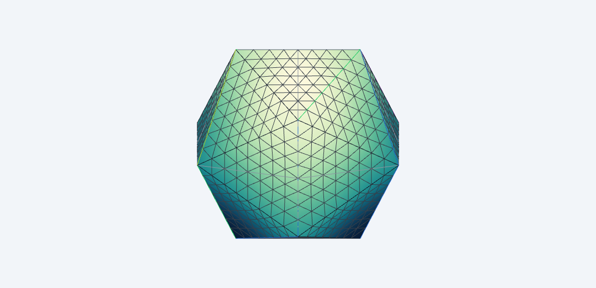
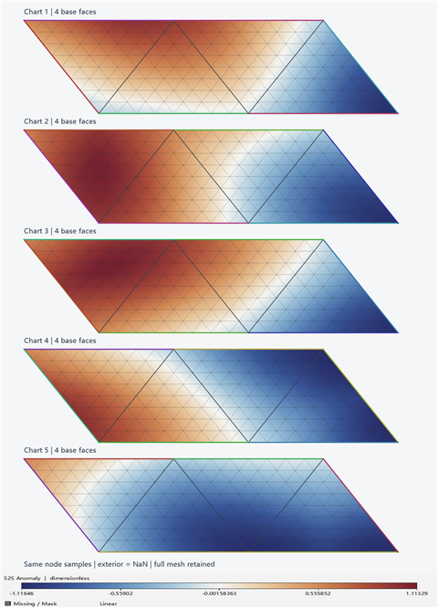
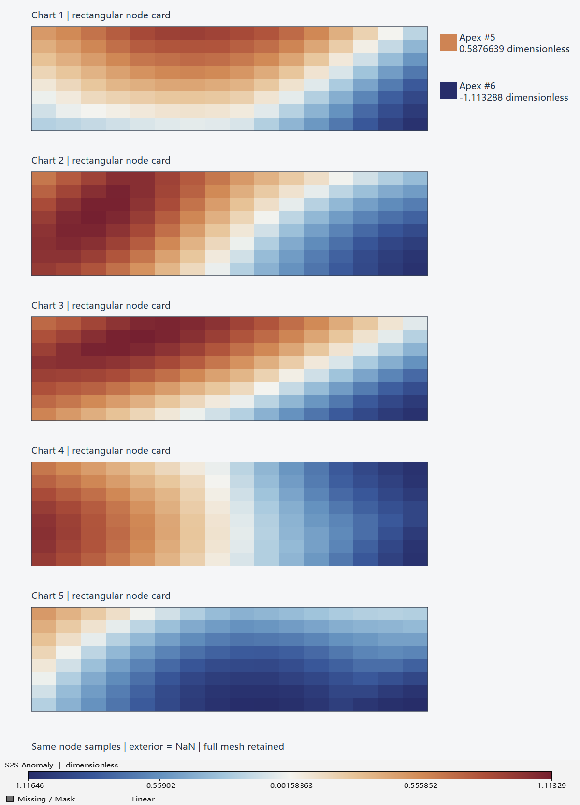

# HDFStudio — NetCDF, HDF5 & GRIB Viewer for Windows

**Unleash the Power of Your NetCDF and GRIB Data**

**English** | [简体中文](README_CN.md) · **Version 0.16.02**

## ⬇️ Download

**0.16.02 brings global and regional fields onto an icosahedral mesh:** explore **2D five-slice layouts**, an interactive **3D sphere or polyhedron**, layer animation and reconstruction errors from the same sampled field. See [Icosahedral analysis](#-icosahedral-analysis-2d-five-slices-and-3d) below.

Binary downloads retain **two versions: 0.16.02 and the previous 0.14.08**. Historical release notes, tags and source archives remain available.

**🔧 Same-version Profile fix (2026-11-27):** the updated portable package restores **Profile** from projected images. Click it to return to **Source grid**, select control points and show the curve. Source-grid sampling and CSV values are unchanged; the application version remains **0.16.02**.

[](https://github.com/DuLiangMin/HDFStudio/releases/latest)
[](https://github.com/DuLiangMin/HDFStudio/releases)
[](LICENSE)
[](https://github.com/DuLiangMin/HDFStudio/releases/download/v0.16.02/HDFStudio-0.16.02-profile-fix-win64.zip)
[](https://www.qt.io/)

**[Download for Windows](https://github.com/DuLiangMin/HDFStudio/releases/download/v0.16.02/HDFStudio-0.16.02-profile-fix-win64.zip)** — **0.16.02 Windows x64 portable binary ZIP (Profile fix)** · [Matching source ZIP](https://github.com/DuLiangMin/HDFStudio/releases/download/v0.16.02/HDFStudio-0.16.02-profile-fix-src.zip) · [Release notes](https://github.com/DuLiangMin/HDFStudio/releases/tag/v0.16.02) · [Previous binary: 0.14.08](https://github.com/DuLiangMin/HDFStudio/releases/tag/v0.14.08)

Includes the application, CLI, GRIB decoder and definitions, runtime libraries and offline help. Unzip and run; no separate dependency download is needed for native browsing.

HDFStudio is a free, open-source Windows tool for inspecting meteorological, climate and scientific data. Browse NetCDF-3/4, HDF5 and native GRIB1/GRIB2, inspect metadata, view values and images, and compare layers in one workspace. Source files are read-only.

**🤖 Friendly to modern LLMs and AI agents:** HDFStudio extracts NetCDF, GRIB and other supported data information into copyable Properties reports, CLI output and numeric CSV. These give models useful reference material to quickly understand dimensions, variables, units, packing and missing values. See the [online help guide](https://duliangmin.github.io/HDFStudio/doc/help.html#en-ai) for workflows and examples.

## 🌐 Icosahedral analysis: 2D five slices and 3D

Right-click a variable and choose **Visual Analysis → Icosahedral 5 slices**. The window opens in the **five unfolded strips** view. It reuses the same variable's open Image layer and Mask, or reads the variable directly when no Image is open. Verified separable longitude/latitude grids are supported, including rectangular Gaussian GRIB with its actual latitude coordinates.

| View | What you can examine |
|---|---|
| **2D — 5 Unfolded Strips** | All 20 base faces arranged in five strips, with four faces per strip, optional mesh lines and matching seam colors. Zoom, pan and use **Fit** to restore the full layout. |
| **2D — 5 Rectangular Charts** | Five node cards with tensor shape **[5, n, 2n]**, where **n = 2^L**. The two remaining Apex nodes are shown and exported separately. |
| **3D — node field / face area** | Rotate, pan and zoom the sphere; morph continuously to the 20-face polyhedron. Inspect node values or unit-sphere face areas, with mesh edges, seams, graticule, geographic presets and optional shading. |
| **Restored source / round-trip error** | Compare the reconstructed source grid with the input and inspect Bias, MAE and RMSE. |



*Actual application rendering of an analytic demonstration field; these illustrations are not forecast data.*

 

**Adjust and animate.** Select **L0–L6** to change mesh resolution. Level changes recompute automatically; rapid changes use the last selection. The previous frame remains visible while updating, and 2D/3D switching stays available. Old-value probes and exports are disabled until the new result is current. Layer controls and **Play/Pause** wait for the source, analysis and displayed frame; playback stops at the last layer. **Run** applies source or Mask changes, and **Cancel** stops the current update.

**Global and regional data.** A regional field is sampled onto the full global mesh only within its verified coordinate bounds. Its exterior remains **NaN**, shown as missing, without wrapping data across the regional boundary. Original values, units and Mask semantics are retained; undeclared units stay unknown.

**Export for further analysis.** Save the complete 2D layout or current 3D framebuffer with its colorbar as PNG. NetCDF exports include mesh topology, node/edge/face point fields, areas, five-card owners and values, separate Apex values, sparse CSR reconstruction weights and error diagnostics. Three Global/S2S palettes complement the existing color maps.

**Scientific scope:** the five slices are an atlas of one source layer, not five vertical levels. Sampling and reconstruction interpolate point values; they do **not** claim conservative cell averages or mass conservation. Areas are on a unit sphere. The atlas Apex nodes are not necessarily geographic poles. Native 3D requires OpenGL 3.3 Core; see [usage, shapes and limitations](docs/ICOSAHEDRAL.md).

## 🚀 Start here

1. Click **Download** above, unzip and run `HDFStudio.exe`; no installer or administrator rights are needed.
2. Choose **File → Open** or drop files onto the window. Expand the tree and right-click a variable for **Properties**, **Data Grid** or **Image View**.
   For the new mesh views, choose **Visual Analysis → Icosahedral 5 slices**, then select the 2D or 3D display mode.
3. Read the [online Chinese/English help](https://duliangmin.github.io/HDFStudio/doc/help.html#en). In the downloaded application, choose **Help → Help** (before About), press **F1**, or double-click the local `doc/help.html` for offline help.

Keep the executable, matching `hdf_cli.exe`, dependency folders and `doc` together. Basic browsing and native analysis need no Python. Optional NetCDF reports, CF checks and calendar labels use Python with the corresponding `netCDF4`, `numpy` and `compliance-checker` modules; `HDFSTUDIO_PYTHON` selects the interpreter.

**🔎 New in 0.14.08:** **File → Find files...** searches a directory by name (including extensionless files); **Find variables...** locates names, paths and descriptions in the current open file. [Usage and limits](docs/SEARCH.md).

**🌍 Map display in 0.14.08:** The single-row **Map projection** bar above Image redraws and remembers longitude/latitude, North/South Polar Stereographic, East Asia Lambert or Mercator as soon as it is selected; no OK click is needed. **Options…** opens live detailed parameters and offline reference-coastline styling. Verified separable NetCDF axes, GRIB `regular_ll` and rectangular Gaussian `regular_gg` grids are supported, preserving actual nonuniform Gaussian latitudes. Map labels use solid text without boxes or outlines; projected playback retains the completed frame until its replacement is ready. Sources without a declared Earth model use explicitly labelled unit-sphere display, with no physical distance or area claim; declared valid models are retained. Source data, analysis and source-resolution PNG remain in the original grid. [Use and limits](docs/PROJECTION.md).

## 🌦️ Native GRIB support

- **Browse GRIB1 and GRIB2 directly:** virtual **Variables** group compatible fields; paged **Messages** preserve physical messages and sub-fields, metadata and provenance.
- **Inspect and visualize:** double-click rectangular variables/fields for **Image View**; decoded, reconstructed **Quantized X** and paired grids, scientific palettes, decoded-value Mask and CSV/PNG export. Quantized X is available only for supported packing and is not a raw-byte dump.
- **Analyze and play:** histograms, curve profiles, whole-plane and 2D texture entropy, comparison metrics, residual maps, integer-index synchronization and layer playback.
- **Space-Time Section (Hovmöller):** independent GUI and CLI sections for rectangular GRIB arrays, arbitrary ordered axes, original reference/step labels, fixed-axis navigation, Mask and PNG/CSV export. Missing slots remain explicit. Geographic-coordinate section axes and U/V vectors remain pending.

Unknown names/units remain unknown; missing or out-of-range fields clear prior results. GRIB images open in source-grid mode, or restore a saved map preference after source validation; eligible regular latitude–longitude and rectangular Gaussian grids can use map display. Comparisons require identical plane shapes and align by integer index, without automatic unit conversion, time matching, reprojection or resampling. CF checks do not apply to GRIB.

## 🧰 Everyday tools

| Task | Feature |
|---|---|
| Inspect values | Copyable Properties; decoded/stored/paired NetCDF/HDF5 grids; automatic column widths, cell selection and Ctrl+C |
| View images | Jet spectrum colors by default, selectable Rainbow and scientific palettes, zoom/pan, flips, decoded-value Mask and full-resolution PNG |
| Inspect distributions | Sampled or full-plane histograms, curve CSV and texture entropy images |
| Compare fields | Pearson r, RMSE, MAE, Bias, `Target − Anchor` residuals and per-target integer lag |
| Browse sequences | Layer controls and Play/Pause; linked views wait for the current data |
| Analyze an icosahedral field | 2D five-strip/card layouts, 3D sphere/polyhedron, automatic L0–L6, reconstruction/errors, PNG and graph NetCDF |
| Slice NetCDF/HDF5/GRIB | Independent **Space-Time Section (Hovmöller)** with any two axes, fixed-axis navigation and PNG/CSV |
| Arrange the workspace | **Window → Tile / Cascade / Hide Infobar** |

NetCDF/HDF5 sections retain source-index cell spacing and verified coordinate labels. Generic HDF5 stays in index space. CF diagnostics are advisory; unsupported encodings and memory limits are reported explicitly. Details are in the [help guide](https://duliangmin.github.io/HDFStudio/doc/help.html#en).


*NetCDF temperature playback beside its synchronized 4×4 texture entropy image.*

**Fit** fills the section plot width and height with smooth display interpolation, including short or single-column sections. Probes, CSV and native-resolution PNG retain the original samples; this display stretch does not interpolate physical coordinates.

## ⌨️ Command-line inspection

```text
hdf_cli probe data.grib2
hdf_cli info data.grib2
hdf_cli props data.grib2 /field/0
hdf_cli csv data.grib2 /field/0 plane.csv
hdf_cli props data.nc /temperature
```

Use the variable/object ID reported for your file. `hdf_cli` shares the application's readers and also provides histogram, entropy, comparison and arbitrary-axis slice commands. See the [GRIB contract](docs/GRIB.md) for tested behavior and current boundaries.

## 🛠️ Build and contribute

Windows development uses Visual Studio 2022 x64, CMake, Qt 6.8, HDF5, netCDF-C, ecCodes and PROJ. Dependency locations and targets are defined in `CMakeLists.txt`, `cmake/Grib.cmake` and `cmake/Projection.cmake`; ecCodes defaults to `ext/eccodes` and can be set with `HDFSTUDIO_ECCODES_ROOT`; PROJ uses an isolated `PROJ_DIR` with matching database and SQLite DLL. Code lives in `src/app`, `src/core`, `src/views` and `src/cli`; tests are in `tests/`. Builds copy the offline guide to `build/output/<configuration>/doc/help.html`.

The public source includes the C17 icosahedral kernels used by this application, their provenance and notices. It omits `tools/`, unused Qt reference copies and the external dependency implementations listed in the manifests. Use the [matching updated source ZIP](https://github.com/DuLiangMin/HDFStudio/releases/download/v0.16.02/HDFStudio-0.16.02-profile-fix-src.zip), [Dependencies](docs/DEPENDENCIES.md) and the [project structure](docs/PROJECT_STRUCTURE.md). Runtime libraries and license texts remain in the binary ZIP. The original `v0.16.02` tag and original source archive are retained; the updated ZIP includes this Profile fix.

Report reproducible problems in [Issues](https://github.com/DuLiangMin/HDFStudio/issues), with the format, object ID, shape and relevant `probe`/`info`/`props` output. Release history is in [Changelog.md](Changelog.md).

## 📜 License and credits

GNU GPL v3 — see [LICENSE](LICENSE). Derived from Pedro Vicente's [HDF Explorer QT Edition](https://github.com/pedro-vicente/hdf_explorer_qt). Dependency and palette attribution is retained in [THIRD_PARTY_NOTICES.md](THIRD_PARTY_NOTICES.md) and `licenses/`.

## 🔎 Keywords

NetCDF viewer, NetCDF browser, NetCDF4 viewer Windows, nc file viewer, open .nc file, HDF5 viewer,
HDF viewer, HDF5 browser, scientific data viewer, climate data viewer, weather data, meteorology,
atmospheric science, oceanography, earth science, climate model output, CMIP, reanalysis, GRIB2 to NetCDF,
CF Conventions, CF-1.8 compliance checker, netCDF4-python, num2date, time decoding, noleap calendar,
latitude longitude grid, Qt6 desktop application, free open source, alternative to Panoply, ncview, HDFView.

GRIB viewer, GRIB1 viewer, GRIB2 viewer Windows, weather forecast data, LLM data inspection, AI agent data tools,
gray-level entropy, Space-Time Section (Hovmöller), icosahedral mesh, 2D five slices, five-chart atlas, 3D globe, OpenGL visualization, spherical grid, layer animation.
