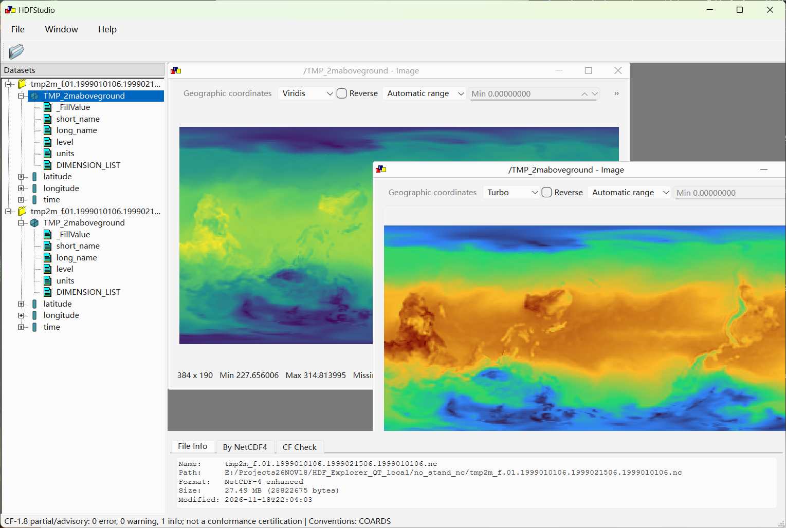

# HDFStudio — Windows 上的 NetCDF / HDF5 查看器

**Unleash Your NetCDF Power.**

[English](README.md) | **简体中文**

[](https://github.com/DuLiangMin/HDFStudio/releases/latest)
[](https://github.com/DuLiangMin/HDFStudio/releases)
[](LICENSE)
[](#-下载与运行)
[](https://www.qt.io/)

HDFStudio 是面向气象、气候与地球科学的 Windows 桌面 **NetCDF 查看器**与 **HDF5 浏览器**，免费开源。打开一个 `.nc`、`.nc4`、`.h5` 或 `.hdf5` 文件，即可浏览组、变量与属性，在表格中查看数值，把二维切片画成图像，按文件自带的日历把时间坐标解码成真实日期，并检查 CF 元信息，全程不需要写代码。



*两个 NetCDF 文件并排打开：2 米气温分别用 Viridis 与 Turbo 调色板绘制；左侧是变量树，底部是 File Info / By NetCDF4 / CF Check 面板。*

## 🤔 为什么用 HDFStudio

拿到模型输出、卫星产品或同事发来的 `.nc` 文件，在敢用之前，你通常得先弄清**里面到底是什么**。常见疑问：

- `time` 的单位是秒还是天？从哪一刻起算？用的什么日历？
- 纬度是南→北还是北→南？经度是 0–360 还是 −180–180？
- 这个文件符合 CF 规范吗，画出来的图会不会上下颠倒？

HDFStudio 几秒内就能回答，不需要开 Python、不需要 notebook、也不需要装整套科学环境。它只是一个小巧的免安装程序（约 15 MB），打开文件就把事实摆出来。

| | HDFStudio | Panoply | ncview | HDFView |
|---|---|---|---|---|
| Windows 原生、免安装 zip | ✅ | 需 Java | ❌ | 需 Java |
| 同时支持 NetCDF **和** HDF5 | ✅ | ✅ | 仅 NetCDF | ✅ |
| 用文件自带日历解码时间 | ✅（`noleap`、`standard` 等） | ✅ | ❌ | ❌ |
| 经纬度方向报告 | ✅ | ❌ | ❌ | ❌ |
| 内置 CF-1.8 规范检查 | ✅ | ❌ | ❌ | ❌ |
| 地图投影与海岸线 | ❌ 暂未支持 | ✅ | ❌ | ❌ |

*对比表反映作者的理解，具体能力请以各工具官方文档为准。*

## ✨ 功能

- 📂 **打开 NetCDF 与 HDF5 文件**：NetCDF-3（CDF-1、CDF-2、CDF-5，0.10.27 起经 netCDF-C 读取）、NetCDF-4 / NetCDF-4 classic、普通 HDF5 容器；可同时打开多个文件，支持拖放。格式按文件头识别，不看 `.nc` 扩展名。
- 🗂️ **干净地关闭文件**：**File → Close File**（`Ctrl+F4` 或 `Ctrl+W`）、**Close All Files**，或在任意节点右键 **Close File**；该文件的视图会随之关闭。
- 🌳 **变量树**：组、维度、变量与属性，带类型和维度大小。
- 🔢 **数值表格**：精确值表格，三维、四维、五维数组可选层。NetCDF-3 文件只读取当前显示的二维平面，700 MB 的变量不到 0.1 秒即可打开。
- ⬆️⬇️ **主工具栏层导航**：打开按钮后面是上一层、下一层、最后一层、第一层与可选的维度/层号下拉框，工具栏实时显示 `Layer n of N`；另有 **Layer** 菜单（`Alt+←`/`Alt+→`/`Alt+Home`/`Alt+End`、`Ctrl+G` 跳转到指定层）。多轴变量（如 `time` 与 `lev`）可先选要翻的维度，再逐层查看。
- 🔍 **属性详情**：类似 `print(netCDF4.Dataset(...))`，给出维度名、unlimited 维度，数组属性会展开显示。
- 🗺️ **图像视图**：二维切片支持连续与离散调色板（Viridis、Inferno、Turbo 等），CF 经纬网悬停可读出经纬度。
- ⏱️ **时间解码**：`seconds since 1970-01-01`、`days since 2024-10-01` 这类 `time` 变量会显示为 `yyyymmdd` 与 `yyyymmdd hh:mm:ss`，经 `netCDF4.num2date` 按文件自身日历解码。
- 🧭 **坐标方向**：By NetCDF4 页报告纬度是南→北还是北→南、经度是东→西还是西→东，这正是地图上下颠倒的常见原因。
- ✅ **CF 规范检查**：调用 IOOS Compliance Checker 生成 CF-1.8 报告，另附内置的只读 CF 元信息诊断。
- 🌬️ **矢量视图**：U/V 风或洋流分量；并提供 **UGRID** 三角网格预览。
- 💾 **导出**：数值导出为文本，切片导出为 PNG；命令行可批量出图。

## 📥 下载与运行

1. 在 [Releases](https://github.com/DuLiangMin/HDFStudio/releases/latest) 页面下载 `HDFStudio-<版本>-win64.zip`。
2. 解压到任意目录，运行 `HDFStudio.exe`。无需安装、无需管理员权限，Qt 与 Visual C++ 运行库已随包提供。

变量树、表格、图像视图与 File Info 页开箱即用。**By NetCDF4** 页、**CF Check** 页和时间解码需要 `PATH` 中的 Python 3（或设置 `HDFSTUDIO_PYTHON`）：

```
pip install netCDF4 numpy compliance-checker
```

命令行可直接打开文件，也可无界面批量出图：

```
HDFStudio.exe a.nc b.nc
HDFStudio.exe --preview PRECT --layer 0 --png out.png data.nc
```

压缩包里还有 `hdf_cli.exe`：它调用与图形界面相同的读取代码，文件打不开或数值可疑时可以先用它排查：

```
hdf_cli probe  data.nc              按文件头判断格式
hdf_cli info   data.nc              维度、变量与属性，排版接近 netCDF4-python
hdf_cli props  data.nc /ttr         Properties 对话框里的那几行
hdf_cli export data.nc /lat         数值导出为文本（加文件名则写入文件）
hdf_cli csv    data.nc /ttr plane.csv 7 42    图像视图所读的那一个二维平面
```

## 🛠️ 从源码构建（Windows）

需要 Visual Studio 2022 x64、CMake、Qt 6.8（`CMAKE_PREFIX_PATH`）、编译到 `build/hdf5-1.8.20` 的 HDF5 1.8.20，以及 `ext/netcdf-c-4.9.3/include` 中的 netCDF-C 4.9.3 头文件和 `build/native-nc/Release` 下的 `netcdf.lib`/`netcdf.dll`。详见 `CMakeLists.txt`；`tools/package-windows.ps1` 用于生成发布 zip。`build.cmake.sh` 是继承而来的 Linux 脚本，本版本未验证。

## 📌 范围

HDFStudio 是查看器与检查器，从不修改输入文件。CF 诊断仅供参考，不构成合规认证。地图投影与任意非结构网格暂不支持。NetCDF-3 的表格按二维平面读取；NetCDF-4 / HDF5 的表格目前仍整体读入变量，分块读取列在路线图中。已验证的格式边界见 `FORMAT_CAPABILITY.md`。

## 🗺️ 路线图

- NetCDF-4 / HDF5 大变量的切片与分块读取
- 地图投影与海岸线叠加
- 更完整的时间轴与日历检查（bounds、不等间隔）
- Linux 与 macOS 版本

欢迎在 [Issues](https://github.com/DuLiangMin/HDFStudio/issues) 提问题和建议。若某个文件打开有误，请附上 `hdf_cli probe file.nc` 与 `hdf_cli info file.nc` 的输出（或用 `ncdump -h file.nc`），这些只有文件头，不含数据。

## 🙏 致谢与许可

作者：DuLiangMin。HDFStudio 派生自 Pedro Vicente 的 [HDF Explorer QT Edition](https://github.com/pedro-vicente/hdf_explorer_qt)（2016），以 GNU GPL v3 发布（见 `LICENSE`）。随包分发的第三方组件（Qt 6.8 LGPL-3.0、netCDF-C 4.9.3、HDF5 1.8.20、zlib）及其许可证列在 `THIRD_PARTY_NOTICES.md`。

如果 HDFStudio 帮你省了时间，给仓库点个 ⭐ 能让更多同行找到它。

## 🔎 关键词

NetCDF 查看器, NetCDF 浏览器, NetCDF4 viewer Windows, nc 文件查看, 打开 nc 文件, HDF5 查看器, HDF5 浏览器, HDF 查看器, 科学数据查看, 气象数据, 气候数据, 大气科学, 海洋学, 地球科学, 模式输出, CMIP, 再分析, GRIB2 转 NetCDF, CF 规范, CF-1.8 检查, netCDF4-python, num2date, 时间解码, noleap 日历, 经纬度网格, Qt6 桌面程序, 免费开源, Panoply 替代, ncview 替代, HDFView 替代。
