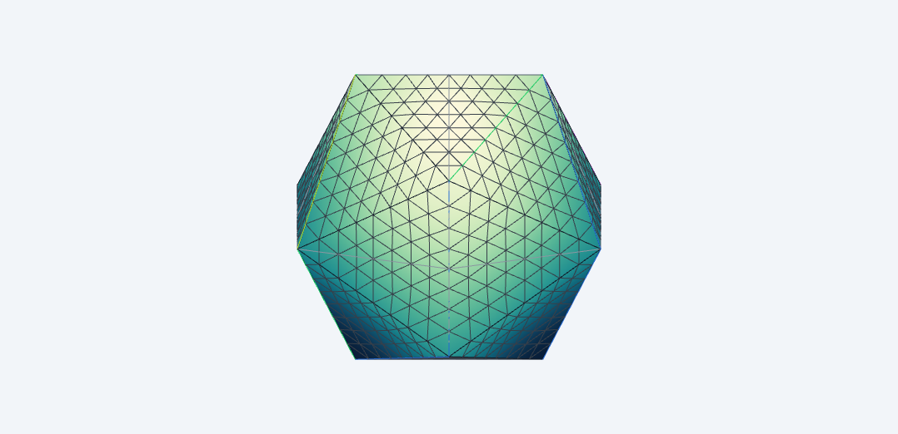
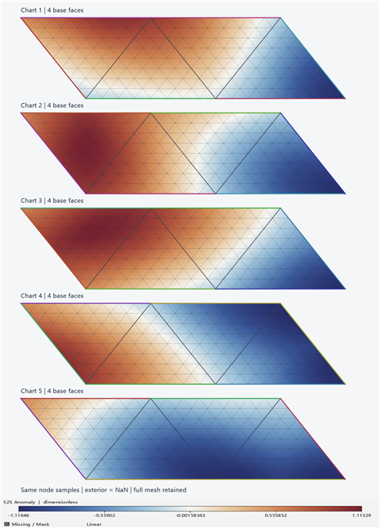
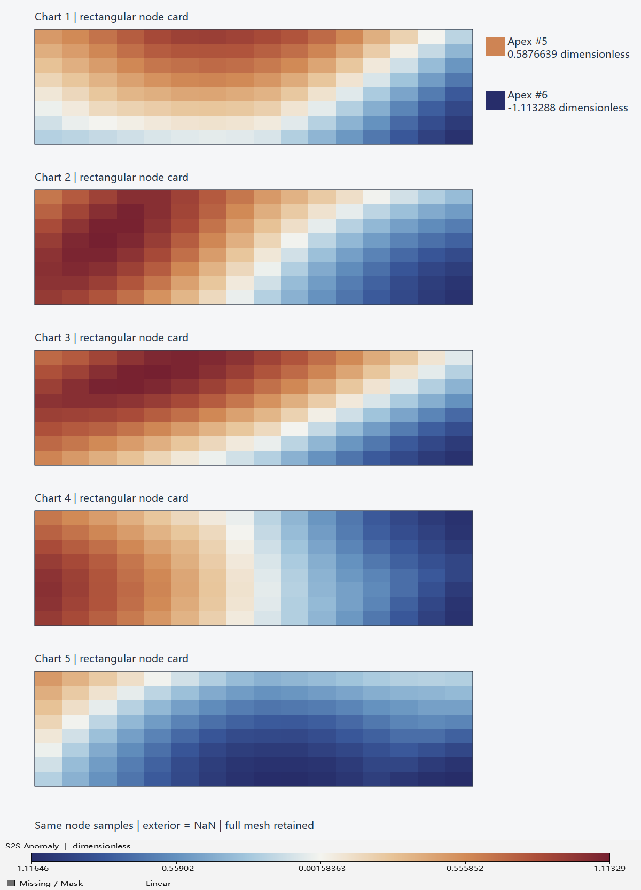
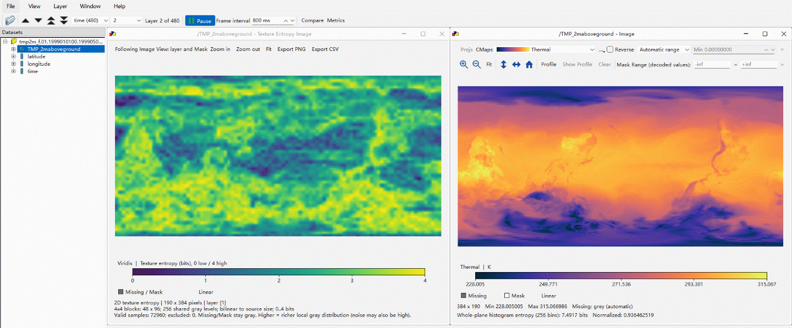

# HDFStudio — Windows 上的 NetCDF、HDF5 与 GRIB 查看器

**Unleash the Power of Your NetCDF and GRIB Data**

[English](README.md) | **简体中文** · **版本 0.16.02**

## ⬇️ 下载

**0.16.02 新增全球与局地场的二十面体分析：** 从同一采样场查看 **2D 五切片展开图**、交互式 **3D 球面/多面体**、逐层动画与还原误差。操作入口和示例见下方「二十面体分析：2D 五切片与 3D」。

二进制下载共保留 **两版：当前 0.16.02 与上一版 0.14.08**。历史版本说明、标签及源码包继续保留。

**🔧 同版本 Profile 修复（2026-11-27）：** 更新包恢复投影地图中的 **Profile** 入口，点击后自动返回 **Source grid**，选取控制点并显示曲线。原格点采样与 CSV 数值不变，程序版本仍为 **0.16.02**。

[](https://github.com/DuLiangMin/HDFStudio/releases/latest)
[](https://github.com/DuLiangMin/HDFStudio/releases)
[](LICENSE)
[](https://github.com/DuLiangMin/HDFStudio/releases/download/v0.16.02/HDFStudio-0.16.02-profile-fix-win64.zip)
[](https://www.qt.io/)

**[下载 Windows 程序](https://github.com/DuLiangMin/HDFStudio/releases/download/v0.16.02/HDFStudio-0.16.02-profile-fix-win64.zip)** — **0.16.02 Windows x64 绿色二进制 ZIP（Profile 修复）** · [匹配更新源码 ZIP](https://github.com/DuLiangMin/HDFStudio/releases/download/v0.16.02/HDFStudio-0.16.02-profile-fix-src.zip) · [版本说明](https://github.com/DuLiangMin/HDFStudio/releases/tag/v0.16.02) · [上一版二进制：0.14.08](https://github.com/DuLiangMin/HDFStudio/releases/tag/v0.14.08)

包含程序、CLI、GRIB 解码器与定义资源、运行库和离线帮助。解压即可运行，基本浏览无需另行下载依赖。

HDFStudio 是面向气象、气候与科研数据的免费开源 Windows 工具。在同一工作区浏览 NetCDF-3/4、HDF5 和原生 GRIB1/GRIB2，检查元信息、查看数值与图像、比较不同数据层。源文件始终只读。

**🤖 对现代 LLM 和 AI Agent 友好：** HDFStudio 能有效提取 NetCDF、GRIB 等受支持数据的信息，通过可复制的 Properties 报告、CLI 输出和数值 CSV，为模型提供参考，帮助其快速掌握维度、变量、单位、打包方式与缺测值等数据特点。操作流程与示例见[在线帮助](https://duliangmin.github.io/HDFStudio/doc/help.html#zh-ai)。

## 🌐 二十面体分析：2D 五切片与 3D

右键变量选择 **Visual Analysis / 可视分析 → Icosahedral 5 slices**，默认打开 **五条展开带**。同变量已打开 Image 时复用其当前层与 Mask，否则直接读取变量。支持验证通过的可分离经纬轴，包含保留真实纬度坐标的完整矩形 Gaussian GRIB 网格。

| 显示模式 | 可查看的内容 |
|---|---|
| **2D — 5 Unfolded Strips** | 将全部 20 个基础三角面展开为五条带，每带四个面；可显示细网格和彩色配对接缝，支持缩放、拖动及 **Fit** 复位。 |
| **2D — 5 Rectangular Charts** | 五张矩形节点卡，张量为 **[5, n, 2n]**，其中 **n = 2^L**；另外两个 Apex 顶点单独显示和导出。 |
| **3D — 节点场 / 面面积** | 球面与 20 面多面体连续变形，旋转、平移、缩放和拾取；支持主棱、细网格、接缝、经纬参考线、地理预设与可选光照。 |
| **还原源格点 / 往返误差** | 查看由二十面体采样还原的源格点与误差，结合 Bias、MAE、RMSE 检查结果。 |



*以上及下方为程序实际渲染的解析演示场，不是预报数据。*

 

**调级与动画。** 选择 **L0–L6** 即自动重算，连续调整使用最后选定的精度。计算期间保留上一图，可继续切换 2D/3D；旧值拾取和导出暂时禁用，新结果完成后恢复。层号控件与 **Play/Pause** 等待源数据、分析及当前显示帧完成再推进，末帧自动停止。**Run / 运行** 应用源或 Mask 修改，**Cancel** 取消当前更新。

**全球与局地场。** 局地数据映射到完整全球二十面体，仅在已验证的真实经纬范围内采样，范围外保持 **NaN** 并显示为缺测，不跨局地区域边界周期拼接。保留原值、单位及 Mask 含义，未声明的单位保持未知。

**用于后续分析的导出。** PNG 保存完整 2D 切片布局或当前 3D 帧缓冲及色标。NetCDF 包含网格拓扑、节点/边/面点值、面积、五卡归属与数值、独立 Apex 值、稀疏 CSR 还原权重及误差诊断；新增三张 Global/S2S 色表。

**科学含义：** 这里的五切片是同一源数据层的网格展开布局，并非五个垂直层。采样与还原属于点值插值，不声称保守单元平均或质量守恒；面积为单位球面积，Apex 也不一定是地理南北极。原生 3D 需要 OpenGL 3.3 Core。详见[操作、数据 shape 与限制](docs/ICOSAHEDRAL.md)。

## 🚀 快速开始

1. 点击上方 **下载 Windows 程序**，解压后运行 `HDFStudio.exe`，无需安装或管理员权限。
2. 使用 **File → Open** 或拖入文件，展开左侧树，右键变量打开 **Properties**、**Data Grid** 或 **Image View**。
   二十面体功能使用 **Visual Analysis / 可视分析 → Icosahedral 5 slices**，再选择 2D 或 3D 显示模式。
3. 点击[在线中英文帮助](https://duliangmin.github.io/HDFStudio/doc/help.html#zh)阅读网页。下载程序后，也可通过 **Help → Help**（位于 About 前）、**F1**，或双击本地 `doc/help.html` 离线阅读。

请保留程序、配套 `hdf_cli.exe`、依赖目录与 `doc`。基本浏览及原生分析无需 Python；可选 NetCDF 报告、CF 检查和日期标签需相应的 `netCDF4`、`numpy`、`compliance-checker` 模块，可通过 `HDFSTUDIO_PYTHON` 指定解释器。

**🔎 0.14.08 新功能：** **File → Find files...** 按名称查找指定目录中的文件，包含无扩展名文件；**Find variables...** 按名称、路径和描述查当前已打开文件的变量。见[操作与限制](docs/SEARCH.md)。

**🌍 0.14.08 地图显示：** Image 顶部 **Map projection** 只占一行，提供经纬度平面、北/南极极射赤面、东亚Lambert和Mercator，选中即重绘并记住，无需点击OK；**Options…** 打开实时预览的详细参数及离线参考岸线设置。接收验证通过的可分离NC经纬轴、GRIB `regular_ll` 和完整矩形高斯网格 `regular_gg`，保留真实非等距高斯纬度。地图文字无底框、无描边；播放期间保留上一完整地图直到新帧就绪。未声明地球模型时明确标记为单位球面显示，不提供物理距离/面积，已有有效模型仍沿用。原值、分析及源分辨率PNG继续使用原格点。见[操作与限制](docs/PROJECTION.md)。

## 🌦️ 原生 GRIB 功能

- **直接浏览 GRIB1 / GRIB2：** 虚拟 **Variables** 组织兼容场；分页 **Messages** 保留物理消息、子场、元信息与来源。
- **查看数值与图像：** 双击矩形变量/场优先打开 **Image View**；支持解码值、重建的 **Quantized X** 和并排表格、科学色表、解码值 Mask，以及 CSV/PNG 导出。Quantized X 仅适用于支持的打包方式，不是原始字节转储。
- **分析与播放：** 直方图、曲线剖面、全平面灰度熵、二维纹理熵、比较指标、残差图、整数索引同步与逐层播放。
- **Space-Time Section (Hovmöller)：** 矩形 GRIB 数组支持独立 GUI/CLI 剖面、任意有序两轴、原始起报/时效标签、固定维导航、Mask 和 PNG/CSV 导出；缺槽显式记录。可靠地理坐标接入和 U/V 矢量仍待后续完成。

未知名称/单位保持未知；缺场或越界会清空旧结果。GRIB图像初始使用源格点，存在已保存的地图偏好时通过源校验后恢复；符合条件的规则经纬网格和完整矩形高斯网格可使用地图显示。比较要求平面形状一致，按整数索引对齐，不自动转换单位、匹配物理时间、投影或重采样。CF 检查不适用于 GRIB。

## 🧰 常用工具

| 任务 | 功能 |
|---|---|
| 检查数值 | 可复制 Properties；NetCDF/HDF5 解码/存储/并排表格；自动列宽、单元格选择与 Ctrl+C |
| 查看图像 | 缺省 Jet 光谱配色，可选 Rainbow 与科学色表，缩放/平移、翻转、解码值 Mask、原分辨率 PNG |
| 分析分布 | 抽样或全平面直方图、曲线 CSV、纹理熵图 |
| 比较数据 | Pearson r、RMSE、MAE、Bias、`Target − Anchor` 残差、各目标独立整数 lag |
| 浏览序列 | 层号控件、Play/Pause；联动视图等待当前数据就绪 |
| 二十面体分析 | 2D 五展开带/矩形卡、3D 球面/多面体、自动 L0–L6、还原/误差、PNG 与图结构 NetCDF |
| NetCDF/HDF5/GRIB 剖面 | 独立 **Space-Time Section (Hovmöller)**，任意两轴、固定维度切换及 PNG/CSV |
| 整理工作区 | **Window → Tile / Cascade / Hide Infobar** |

NetCDF/HDF5 剖面保留源索引等宽显示和已验证坐标标签；通用 HDF5 使用索引含义。CF 诊断仅供参考，不支持的编码与内存限制会明确提示。细节见[使用帮助](https://duliangmin.github.io/HDFStudio/doc/help.html#zh)。



*NetCDF 气温逐层播放，以及跟随其变化的 4×4 纹理熵图。*

**Fit** 通过平滑显示插值铺满剖面绘图区的宽度和高度，短剖面或单列剖面也能展开。探针、CSV 与原始分辨率 PNG 保留原采样，不插值物理坐标。

## ⌨️ 命令行提取信息

```text
hdf_cli probe data.grib2
hdf_cli info data.grib2
hdf_cli props data.grib2 /field/0
hdf_cli csv data.grib2 /field/0 plane.csv
hdf_cli props data.nc /temperature
```

变量/对象 ID 以实际文件报告为准。`hdf_cli` 与界面共用读取核心，也提供直方图、熵、比较及任意轴剖面命令。已验证行为与当前边界见 [GRIB 说明](docs/GRIB.md)。

## 🛠️ 构建与反馈

Windows 开发使用 Visual Studio 2022 x64、CMake、Qt 6.8、HDF5、netCDF-C、ecCodes 和 PROJ。依赖位置与目标见 `CMakeLists.txt`、`cmake/Grib.cmake`、`cmake/Projection.cmake`；ecCodes 默认位于 `ext/eccodes`，可用 `HDFSTUDIO_ECCODES_ROOT` 配置；PROJ通过独立`PROJ_DIR`定位，并部署匹配数据库与SQLite DLL。源码位于 `src/app`、`src/core`、`src/views`、`src/cli`，测试位于 `tests/`。构建会把帮助页复制到 `build/output/<配置>/doc/help.html`。

公开源码包含本程序使用的 C17 二十面体核、来源与许可；不附 `tools/`、未参与编译的 Qt 参考副本及清单中列出的外部依赖实现。请使用[匹配更新源码 ZIP](https://github.com/DuLiangMin/HDFStudio/releases/download/v0.16.02/HDFStudio-0.16.02-profile-fix-src.zip)，构建依赖见[依赖说明](docs/DEPENDENCIES.md)和[项目结构树](docs/PROJECT_STRUCTURE.md)。二进制 ZIP 保留完整运行库与许可证。原 `v0.16.02` 标签和原始源码包继续保留，更新源码 ZIP 包含本次 Profile 修复。

问题请提交至 [Issues](https://github.com/DuLiangMin/HDFStudio/issues)，附格式、对象 ID、shape 和相关 `probe`/`info`/`props` 输出。历史更新见 [Changelog.md](Changelog.md)。

## 📜 许可与致谢

采用 GNU GPL v3，见 [LICENSE](LICENSE)。基于 Pedro Vicente 的 [HDF Explorer QT Edition](https://github.com/pedro-vicente/hdf_explorer_qt)。依赖与色表署名保留于 [THIRD_PARTY_NOTICES.md](THIRD_PARTY_NOTICES.md) 和 `licenses/`。

## 🔎 关键词

NetCDF 查看器, NetCDF 浏览器, NetCDF4 viewer Windows, nc 文件查看, 打开 nc 文件, HDF5 查看器, HDF5 浏览器, HDF 查看器, 科学数据查看, 气象数据, 气候数据, 大气科学, 海洋学, 地球科学, 模式输出, CMIP, 再分析, GRIB2 转 NetCDF, CF 规范, CF-1.8 检查, netCDF4-python, num2date, 时间解码, noleap 日历, 经纬度网格, Qt6 桌面程序, 免费开源, Panoply 替代, ncview 替代, HDFView 替代。

GRIB 查看器, GRIB1 查看器, GRIB2 viewer Windows, 天气预报数据, LLM 数据检查, AI Agent 数据工具,
gray-level entropy, Space-Time Section (Hovmöller), 二十面体网格, 2D五切片, 五卡展开, 3D球面, OpenGL可视化, 球面网格, 逐层动画。
