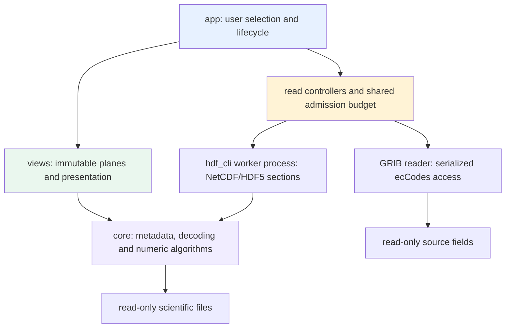
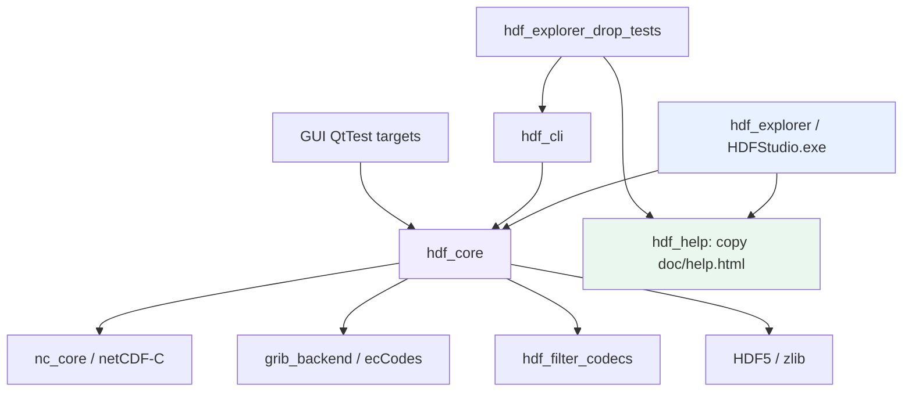

# 🧭 Project structure / 项目结构

## 📂 Source and data locations

```text
HDFStudio/
├── CMakeLists.txt            Application, shared libraries, tests and help deployment
├── cmake/Grib.cmake          ecCodes import and native runtime deployment
├── src/
│   ├── app/                 Main window, file tree, navigation, scheduling, controllers
│   ├── views/               Tables, raster, sections, curves, entropy and comparisons
│   ├── core/                Format-neutral metadata, readers, decoding and algorithms
│   │   └── grib/            GRIB catalog, field identity, planes and source adapters
│   └── cli/                 hdf_cli: metadata, exports and isolated section worker
├── doc/help.html            Offline Chinese/English user guide, opened by Help / F1
├── docs/                    Architecture, GRIB contract, screenshots and demo
├── resources/               Qt assets and generated offline color-map data
├── licenses/                Dependency notices and pinned native-file manifest
├── third_party/hdf_filters/ Build recipe, source URLs/hashes and local decoder sources
├── tests/                   QtTest, independent numeric and desktop verification
├── testdata/                Small generated fixtures; no business data
├── tools/                   Dependency restore, source filtering and packaging
├── ext/                     Local development dependencies; excluded from publication
├── build/                   Generated projects, executables and packages; local only
└── logs/                    Timestamped verification evidence; local only
```

**输入 / Inputs:** user-selected read-only scientific files; optional business-test paths come from `HDFSTUDIO_*` environment variables. Dependencies are configured by `CMakeLists.txt`, `cmake/Grib.cmake` and the pinned manifests. Do not put business files into source or release archives.

**输出 / Outputs:** development executables and `doc/help.html` go to `build/output/<configuration>/`. Tests write to `logs/<feature>/`; exports go to explicit user-selected paths. `tools/package-windows.ps1` writes versioned binary/source archives to a separate package directory. Section workers use application-owned temporary directories, never the input directory.

## 🧱 Responsibilities and data flow



Core algorithms do not depend on Qt Widgets. `app` owns selection, cancellation and lifecycle; `views` presents snapshots and retains their memory leases. GRIB work is serialized around ecCodes. NetCDF/HDF5 section reads stay in the matching CLI process. The GUI and CLI use the same scientific decoding rules; the help page has no role in data reading.

## 🔗 Build targets and the help dependency fix

Arrows below mean “depends on”. Qt/native dependency edges are summarized for readability.



The help target only reads `doc/help.html` and writes `build/output/$<CONFIG>/doc/help.html`. It does **not** depend on the executable. The executable and menu test depend on help deployment, ensuring that the file exists before running them. The always-run copy target also updates HTML-only changes without relinking the executable.

The first implementation used `$<TARGET_FILE_DIR:hdf_explorer>` inside `hdf_help`. CMake inferred `hdf_help → hdf_explorer`, which conflicted with the explicit `hdf_explorer → hdf_help` edge. The fixed target uses the configured output-directory contract directly; configure/generate and both configurations must pass before committing.

## 📦 Public source and complete binaries

The publication policy excludes third-party library source copies and upstream cmap Python copies from the public tree and source ZIP. `tools/public-source-excludes.txt` defines the filter. The packaging script checks the selected public source reference and refuses any remaining excluded files. Versions, URLs, hashes, licenses and integration/build recipes are retained. Local dependency files remain available for development, and adapted HDFStudio application code remains part of the project.

Run `python tools/26NOV23_v01_restore_hdf_filters.py` to restore the pinned HDF filter sources before building a public checkout. It uses `third_party/hdf_filters/sources.json`, verifies SHA256 before writing and never overwrites a different existing file. Other development dependencies and optional color-source regeneration are described in [DEPENDENCIES.md](DEPENDENCIES.md).

The Windows ZIP includes the GUI, matching CLI, Qt/platform plugins, netCDF/GRIB runtime libraries, embedded ecCodes definitions/samples, help, palettes and license texts. The recipe verifies the pinned GRIB DLL hashes and refuses to overwrite an existing package. End users need no compiler or Python for native browsing and analysis.
