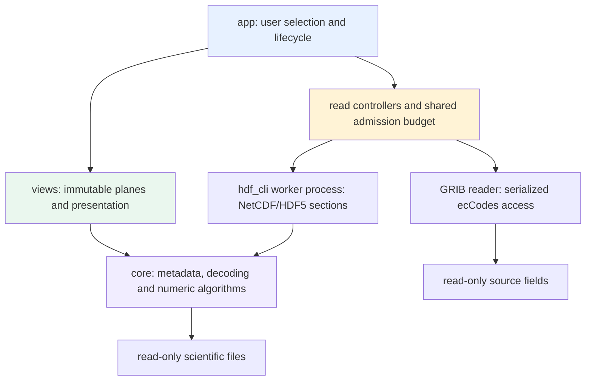
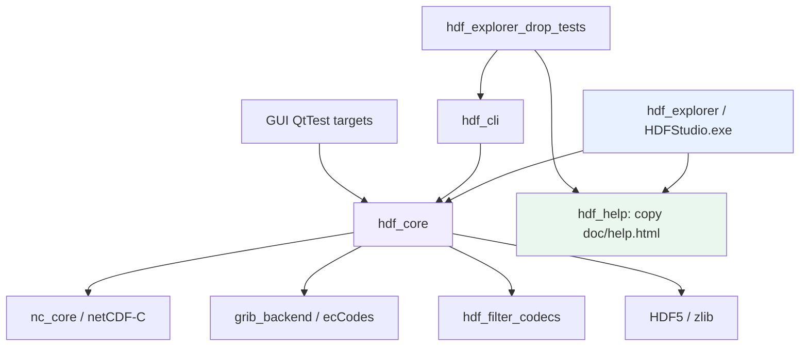

# 🧭 Project structure / 项目结构

## 📂 Source and data locations

```text
HDFStudio/
├── CMakeLists.txt            Application, shared libraries, tests and help deployment
├── cmake/Grib.cmake          ecCodes import and native runtime deployment
├── src/
│   ├── app/                 Product entrypoint, main window, browser payload, controllers
│   ├── views/               Tables, raster, sections, curves, entropy and comparisons
│   ├── core/                Format-neutral metadata, readers, decoding and algorithms
│   │   └── grib/            GRIB catalog, field identity, planes and source adapters
│   └── cli/                 hdf_cli: metadata, exports and isolated section worker
├── doc/help.html            Offline Chinese/English user guide, opened by Help / F1
├── docs/                    ADRs, architecture, GRIB contract, screenshots and demo
├── resources/               Qt assets and generated offline color-map data
├── licenses/                Dependency notices and pinned native-file manifest
├── third_party/hdf_filters/ Build recipe, source URLs/hashes and local decoder sources
├── tests/                   QtTest, independent numeric and desktop verification
├── testdata/                Small generated fixtures; no business data
├── tools/                   Local maintenance scripts; excluded from publication
├── ext/                     Local development dependencies; excluded from publication
├── build/                   Generated projects, executables and packages; local only
└── logs/                    Timestamped verification evidence; local only
```

**输入 / Inputs:** user-selected read-only scientific files; optional business-test paths come from `HDFSTUDIO_*` environment variables. Dependencies are configured by `CMakeLists.txt`, `cmake/Grib.cmake` and the pinned manifests. Do not put business files into source or release archives.

**输出 / Outputs:** development executables and `doc/help.html` go to `build/output/<configuration>/`. Tests write to `logs/<feature>/`; exports go to explicit user-selected paths. Release archives are staged separately by local maintenance scripts, which are not published. Section workers use application-owned temporary directories, never the input directory.

## 🧱 Responsibilities and data flow



Core algorithms do not depend on Qt Widgets. `app` owns selection, cancellation and lifecycle; snapshot-based views retain their memory leases. The legacy HDF/NetCDF grid still borrows a tree-owned typed buffer, so dependent windows must be destroyed before their `ItemData`. GRIB work is serialized around ecCodes. NetCDF/HDF5 section reads stay in the matching CLI process. The GUI and CLI use the same scientific decoding rules; the help page has no role in data reading.

## 🧩 Application module interfaces

The [application boundaries](architecture/application-boundaries.md) describe the current ownership and dependency contracts. [ADR-0001](adr/0001-document-authority.md) records document authority; [ADR-0002](adr/0002-application-module-boundaries.md) records the incremental source split. New decisions use the [ADR index and template](adr/README.md).

- `app/main.cpp` contains the product entrypoint and preview path; it is excluded from GUI QtTest source lists. `app/startup_splash.*` supplies the shared startup widget.
- `views/legacy_grid.*` exposes `GridValueMode` and `create_legacy_grid`; `TableModel` and `ChildWindow` remain private implementation classes. Existing `LayerNavigation` connects the returned widget to main-window controls.
- `app/browser_item.hpp` owns the compatibility payload declarations. `app/legacy_grid_data.*` contains shared classic-NetCDF buffer loading. These are transitional application contracts, not format-neutral core APIs.
- `app/hdf_explorer.*` retains workspace composition, file-tree actions and format traversal. File-tree/private-main-window coupling is a future boundary to define separately.

Current tasks and private data locations live outside the public product repository, under the workspace's `docs/internal/`. Architecture documents do not embed business paths or duplicate mutable task status.

## 🔗 Build targets and the help dependency fix

Arrows below mean “depends on”. Qt/native dependency edges are summarized for readability.



The help target only reads `doc/help.html` and writes `build/output/$<CONFIG>/doc/help.html`. It does **not** depend on the executable. The executable and menu test depend on help deployment, ensuring that the file exists before running them. The always-run copy target also updates HTML-only changes without relinking the executable.

The first implementation used `$<TARGET_FILE_DIR:hdf_explorer>` inside `hdf_help`. CMake inferred `hdf_help → hdf_explorer`, which conflicted with the explicit `hdf_explorer → hdf_help` edge. The fixed target uses the configured output-directory contract directly; configure/generate and both configurations must pass before committing.

## 📦 Public source and complete binaries

The publication policy excludes the entire `tools/` directory, third-party library source copies and upstream cmap Python copies from the public tree and updated source ZIP. Versions, URLs, hashes, licenses and integration/build recipes are retained. Local maintenance scripts and dependency files remain available for development; adapted HDFStudio application code remains part of the project.

Before building a public checkout, download the pinned HDF filter files from the URLs in `third_party/hdf_filters/sources.json`, place them under the recorded relative paths and verify SHA256. Development dependency locations and optional palette provenance are described in [DEPENDENCIES.md](DEPENDENCIES.md).

The Windows ZIP includes the GUI, matching CLI, Qt/platform plugins, netCDF/GRIB runtime libraries, embedded ecCodes definitions/samples, help, palettes and license texts. The recipe verifies the pinned GRIB DLL hashes and refuses to overwrite an existing package. End users need no compiler or Python for native browsing and analysis.
