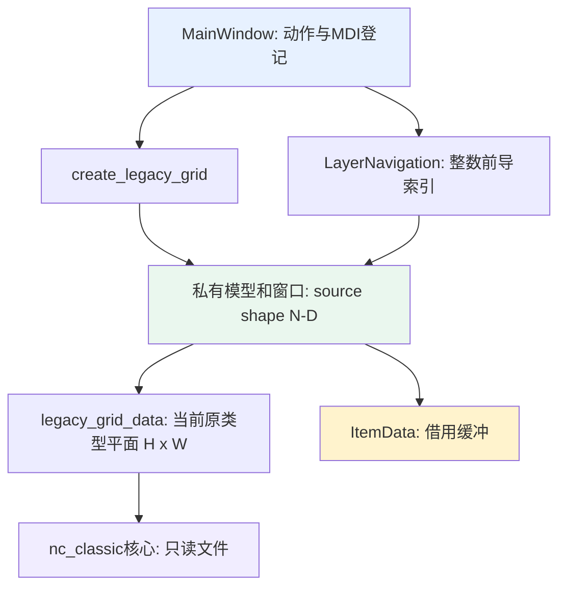

# 🧱 Application boundaries / 应用模块边界

依据[ADR-0002](../adr/0002-application-module-boundaries.md)。源码在`src/`，配置`CMakeLists.txt`；输入为用户选择的只读文件或`HDFSTUDIO_*`配置；输出为`build/output/<configuration>/`、测试`logs/<feature>/`及用户指定导出位置。业务路径不写入源码。

## 🗂️ 本轮形成的模块

| 模块 | 输入 → 输出 | 所有权与限制 |
| --- | --- | --- |
| `app/main.cpp` | 命令行 → GUI或原有preview输出 | 只编入产品；测试提供自己的main |
| `app/startup_splash.*` | 字体/屏幕 → 启动QWidget | 调用者拥有；产品与专项测试共用 |
| `app/hdf_explorer.*` | 用户动作 → 文件/窗口登记与路由 | 仍持有文件树、HDF遍历和工作区组装 |
| `app/browser_item.hpp` | 树载荷 → dataset或GRIB对象引用 | ItemData拥有dataset，dataset拥有malloc缓冲；不是公共核心DTO |
| `app/legacy_grid_data.*` | ItemData＋leading indices → 经典NC原类型缓冲 | 高维只读当前平面；原预算/错误行为保持 |
| `views/legacy_grid.*` | 已装载ItemData＋模式 → QWidget表格 | 模型与导航实现私有；借用载荷，不能访问MainWindow |
| `views/grib_table_view.*` | GRIB对象身份 → 专用表格 | 继续使用原控制器，不走legacy缓冲 |
| `core/search.*` | 目录/文件名或变量描述 → 值结果 | 无QtWidgets或科学文件读取；限额、错误、协作取消明确返回 |
| `app/browser_search.*` | 已建立的树元信息 → 描述与持久模型索引 | 不拥有ItemData；GRIB只取Variables，不重复扫描Messages |
| `views/search_panel.*` | 两个查询入口 → 打开/定位请求 | 拥有控件并管理扫描；线程独立存活至完成并延迟清理；主窗口持有科学文件，关闭源先失效结果 |
| `core/map_projection.*` | 明确模型、参数、lon/lat度 → 投影米/角度 | 每实例独占PROJ context/operation，禁用网络，无QtWidgets |
| `core/geo_grid.*` | NC/GRIB已关联坐标 → 可分离lat[H]/lon[W]及模型证据 | NC读取只在CLI进程，GRIB使用现有已对齐平面；严格准入，不猜CRS |
| `app/geo_grid_controller.*` | source/stamp/shape请求 → 不可变grid与lease | 同目录CLI、协议身份校验、全局调度、取消与dispose收尾 |
| `core/map_render.*` / `core/coastline.*` | 只读平面、坐标、资源、viewport → RGBA/源索引/状态/几何 | 物理像素逆变换最近邻，保持原值；有界岸线几何、hash及预算 |
| `views/map_display.*` | 设置/缩放平移 → 地图呈现与同像素探针 | 不替换源缓存；active＋latest，失效时清探针，关应用等待遗留任务释放 |

## 🔌 表格公共接口

`QWidget *create_legacy_grid(QWidget *parent, ItemData *item_data, GridValueMode mode)`。

前提：item_data非空、dataset及相应buffer已装载，kind为变量或数值属性。输出有原`gridTable`和`gridAnalysisToolbar`，模式为Decoded/Stored/Both；数值布局遵循源shape与前导索引。窗口经现有`LayerNavigation`接受层控制；主窗口不依赖TableModel/ChildWindow实现。

## 🧯 销毁与异步边界

文件关闭仍先销毁关联MDI视图，再删除树节点ItemData及buffer。表格不得删除载荷，不将借用buffer传到后台长期持有。日期QProcess归表格窗口，原有信号接收对象和错误回退保持。Q_OBJECT类留在cpp并包含`legacy_grid.moc`，保持类名、信号和Qt元对象身份。

栅格/GRIB/剖面的不可变快照、budget lease、latest、取消和直接关窗契约沿原模块；此次不改变科学算法。

地图边界见[ADR-0004](../adr/0004-map-projection-display.md)。RasterView保留源图与源数据缓存，MapDisplay只显示重采样结果；原PNG从源缓存导出。线程捕获不可变值、坐标及lease，不访问QWidget或netCDF/HDF5。应用退出同时取消坐标进程和地图任务，并等待包括已删除视图的遗留任务收尾；岸线失败单独降级，不冒充科学海陆Mask。

投影选择在RasterView独立单行栏直接生效并保存，无需OK；状态/配置错误共用该行，全文保留在tooltip，画布不重复显示同一状态。坐标就绪前只保留最后选择；GRIB请求身份同时比较indices和coordinates需求，首帧读取期间可升级到带坐标请求。MapDisplay管理Options预览事务和程序根目录`HDFStudio.ini`：主栏选择/窗口OK写盘，Cancel/Esc/标题栏关闭回退显示但不写盘。INI不持有科学数据或源模型；每个新图按当前源重新准入。无声明地球模型时，MapDisplay只在显示Spec使用a=b=1单位球并明确标记，不修改GeoGrid的unknown身份，也不向科学输出或距离/面积提供模型。显式冲突/非法模型仍拒绝。损坏/不可写须可见，测试通过`HDFSTUDIO_SETTINGS_FILE`隔离。

搜索边界由[ADR-0003](../adr/0003-search-boundaries.md)记录。“当前文件”取文件树选中节点所属根，无选中节点时取最后一个已打开根，不按活动Image窗口推断。变量检索通过`QPersistentModelIndex`定位；主窗口执行动作前校验有效性、模型和文件根。变量表10000条展示上限不限制完整目录构建，目前目录与过滤仍在GUI线程。文件系统线程以原子标记协作取消，面板析构断开回调；线程结束后经deleteLater清理，依赖GUI事件循环，不承诺进程退出前已完成析构。隐藏面板不取消扫描，销毁不等待不可控的文件系统调用。

## 🔄 后续演进触发条件

文件树增加新的MainWindow私有访问时，先定义浏览动作/窗口登记接口；多个表格后端确需复用时，再设计数据提供者替代ItemData。不要把兼容载荷移进core或扩展成通用服务定位器。每次只替换一个边界，并验证它的直接消费者。
