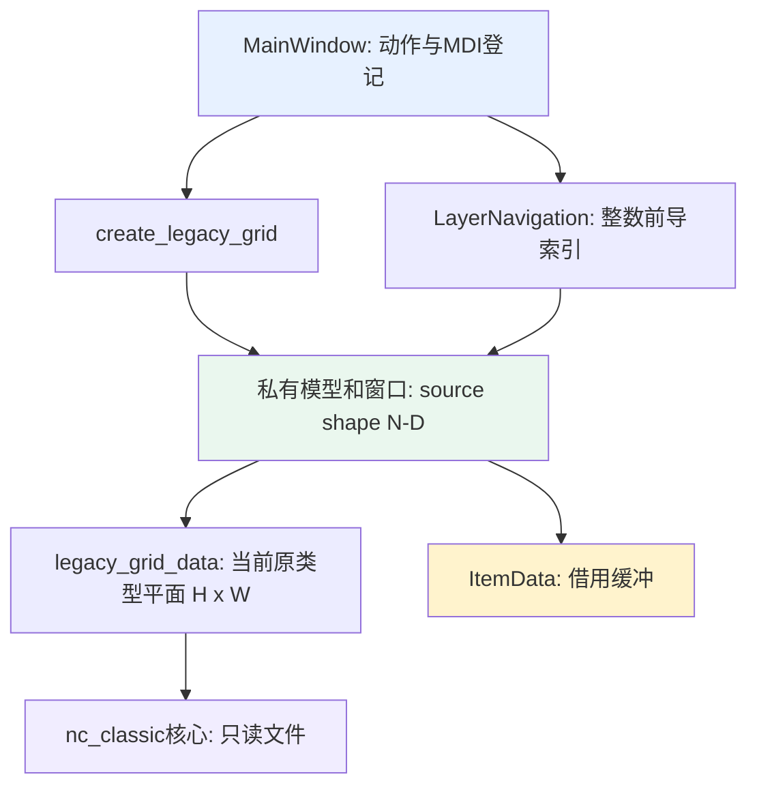

# 🧱 Application boundaries / 应用模块边界

依据[ADR-0002](../adr/0002-application-module-boundaries.md)。源码在`src/`，配置`CMakeLists.txt`；输入为用户选择的只读文件或`HDFSTUDIO_*`配置；输出为`build/output/<configuration>/`、测试`logs/<feature>/`及用户指定导出位置。业务路径不写入源码。

## 🗂️ 本轮形成的模块

| 模块 | 输入 → 输出 | 所有权与限制 |
| --- | --- | --- |
| `app/main.cpp` | 命令行 → GUI或原有preview输出 | 只编入产品；测试提供自己的main |
| `app/startup_splash.*` | 字体/屏幕 → 启动QWidget | 调用者拥有；产品与专项测试共用 |
| `app/hdf_explorer.*` | 用户动作 → 文件/窗口登记与路由 | 仍持有文件树、HDF遍历和工作区组装 |
| `app/browser_item.hpp` | 树载荷 → dataset或GRIB对象引用 | ItemData拥有dataset，dataset拥有malloc缓冲；不是公共核心DTO |
| `app/legacy_grid_data.*` | ItemData＋leading indices → 经典NC原类型缓冲 | 高维只读当前平面；原预算/错误行为保持 |
| `views/legacy_grid.*` | 已装载ItemData＋模式 → QWidget表格 | 模型与导航实现私有；借用载荷，不能访问MainWindow |
| `views/grib_table_view.*` | GRIB对象身份 → 专用表格 | 继续使用原控制器，不走legacy缓冲 |

## 🔌 表格公共接口

`QWidget *create_legacy_grid(QWidget *parent, ItemData *item_data, GridValueMode mode)`。

前提：item_data非空、dataset及相应buffer已装载，kind为变量或数值属性。输出有原`gridTable`和`gridAnalysisToolbar`，模式为Decoded/Stored/Both；数值布局遵循源shape与前导索引。窗口经现有`LayerNavigation`接受层控制；主窗口不依赖TableModel/ChildWindow实现。

## 🧯 销毁与异步边界

文件关闭仍先销毁关联MDI视图，再删除树节点ItemData及buffer。表格不得删除载荷，不将借用buffer传到后台长期持有。日期QProcess归表格窗口，原有信号接收对象和错误回退保持。Q_OBJECT类留在cpp并包含`legacy_grid.moc`，保持类名、信号和Qt元对象身份。

栅格/GRIB/剖面的不可变快照、budget lease、latest、取消和直接关窗契约沿原模块；此次不改变科学算法。

## 🔄 后续演进触发条件

文件树增加新的MainWindow私有访问时，先定义浏览动作/窗口登记接口；多个表格后端确需复用时，再设计数据提供者替代ItemData。不要把兼容载荷移进core或扩展成通用服务定位器。每次只替换一个边界，并验证它的直接消费者。
